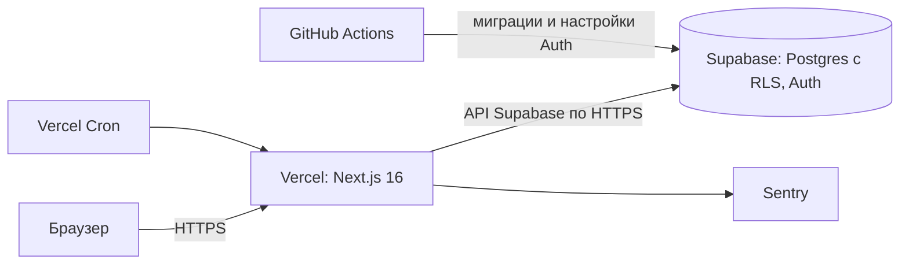

# Архитектура <Проект>

## 0. Как читать

Здесь записано, как устроена система и почему: архитектурные решения, правила кода и бизнес-правила заказчика, ставшие правилами системы. Документ описывает только то, что верно сейчас. История решений — в журнале [decisions.md](knowledge/decisions.md), подробности крупного решения — в `knowledge/decisions/D-NNN.md`. Как писать код — `.claude/rules/` и README. Запись состоит из четырёх пунктов: **Решение** (что делаем), **Почему** (причина и отклонённая альтернатива), **Для кода** (где это живёт или какой блок это строит), **Основание** (номер решения, требования реестра, раздел ТЗ, дата). Пометка «предложено» значит: решение ждёт согласия заказчика, но код уже строится на нём. Что ещё не решено — [open-questions.md](knowledge/open-questions.md). Как вести документ — `.claude/rules/docs.md`; предел — 400 строк, ссылки на решения сверяет с журналом `npm run docs:check`.

Разделы ниже — заготовка: на старте проекта (B00-T02) в них переносятся решения из ТЗ и журнала, раздел без решений остаётся с подсказкой. Запись в разделе 3 — образец формата.

## 1. Картина целиком

_Что уже работает, что появится и в каком блоке._

## 2. Стек и размещение

_Хостинг и регионы, аккаунты и кому они принадлежат, тарифы, резервные копии, доступ к базе, закреплённые версии инструментов. Значения шаблона — README, «Новый проект из шаблона», и `docs/release.md`._

## 3. Слои кода и модули

### Модули и четыре слоя (D-001)

- **Решение.** Код делится на модули по сущностям; внутри модуля четыре слоя — `domain`, `application`, `infrastructure`, `ui`, — и зависимости направлены только внутрь, к `domain`.
- **Почему.** Правила и расчёты проверяются unit-тестами без базы и браузера, а замена базы или внешнего API не трогает ядро. Отклонено: раскладка по типам файлов (`components`, `lib`, `api`) — одно правило расползается по папкам, и его не проверить линтером.
- **Для кода.** `src/modules/<модуль>/`, сборка модуля — `server.ts`; границы слоёв проверяет линтер (`boundaries/*` в `eslint.config.mjs`); новый модуль — `npm run new:module`. Подробно — README, «Архитектура: модули и четыре слоя».
- **Основание.** D-001.

## 4. Данные и доступ

_Владелец данных и роли, права по объекту в RLS, второй фактор на уровне базы, общие и служебные колонки, удаление и связи, большие выборки. Значения шаблона — `.claude/rules/db.md`, `db-tables.md`, `security.md`._

## 5. Деньги и расчёты

_Тип сумм и валюта рядом, округление, курсы, методики расчёта. Значения шаблона — `.claude/rules/db-money.md`, `code-style.md`._

## 6. Вход и безопасность

_Способ входа, сессии, периметр, CSP, где живут ключи. Значения шаблона — `.claude/rules/auth.md`, `security.md`._

## 7. Интеграции

_Внешние API, файлы, почта: что вызываем, где лимиты и что при отказе._

## 8. CI/CD и выпуск

_Среды, выпуск в production, миграции только вперёд, обязательные проверки `main`, контрольные точки CI. Значения шаблона — `docs/release.md`, `.github/workflows/`._

## 9. Производительность

_Бюджет страниц и JS, где считаются итоги, кэш. Значения шаблона — README, «Производительность», `tests/perf/pages.ts`._

## 10. Наблюдаемость

_Ошибки и логи: куда уходят, что в них нельзя писать. Значения шаблона — `docs/release.md`, «Sentry» и «Логи»._
